# Ideas

Furniture ideas and inspiration I want to remember. Photos sit next to this file. Each idea has a table of products I could actually buy from stores that deliver to Austin, with their pictures in a folder named after the idea.

## Coffee-table footrest

A soft, upholstered footrest that turns into a coffee table when I set a tray or table top on it, the way a sofa arm table works. Feet up most of the time, a flat surface when I need one.

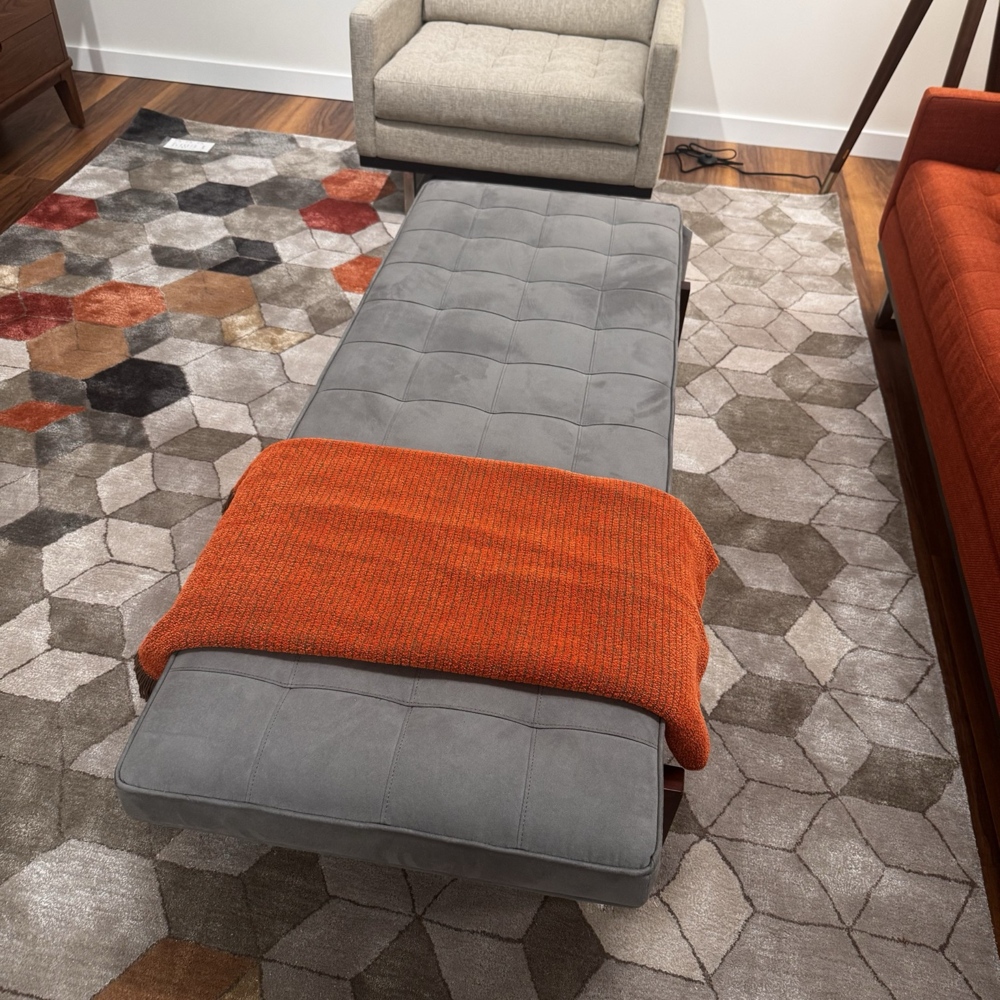

Seen in a store (2026-11-02): a long, low grey suede ottoman with square tufting on a dark walnut frame. It's a long bench, not a square pouf, so it can sit in front of the sofa like a coffee table. What I like:

- Long enough for two people's feet, or one person lying across it.
- Firm, flat top, so a rigid tray or a slide-over table stays level.
- Walnut base matches the mid-century look.

To figure out: a tray with a flat bottom versus a C-shaped slide-over table versus a top that clips on; whether the top should be firm enough to hold drinks without a tray; and how its height compares to the sofa seat.

Nothing for sale matches the photo exactly: about 40–65" long, a firm tufted top and wood legs. Prices and sizes were checked on each product page on 2026-11-02. Sizes are W × D × H in inches.

**Ottomans**

|                                                                                           | Item                                                                                                                                       | Price                      | Size               | Why                                                                                         |
| ----------------------------------------------------------------------------------------- | ------------------------------------------------------------------------------------------------------------------------------------------ | -------------------------- | ------------------ | ------------------------------------------------------------------------------------------- |
| 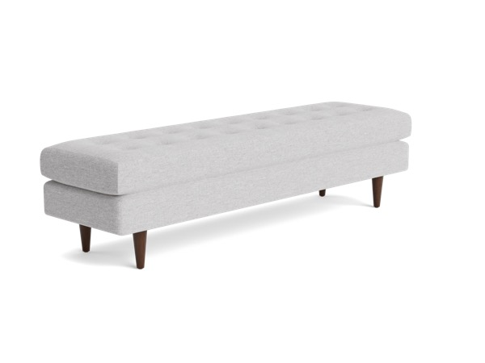                     | [Joybird Eliot Bench](https://joybird.com/benches/eliot-bench/?fabric=milo-dove)                                                           | $1,383 (sale, reg. $2,127) | 72 × 21 × 18       | Closest to the photo: button-tufted grey top on tapered walnut legs. Long, ships in 5 weeks |
| 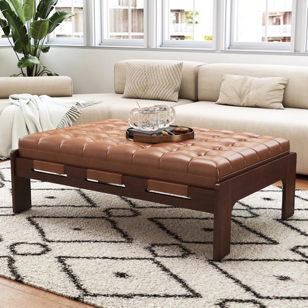           | [chairus Rectangle Ottoman Coffee Table](https://www.amazon.com/dp/B0FPXHC147)                                                             | $299.99 + $39.99 delivery  | 47.75 × 32 × 16.75 | Same shape as the photo: biscuit tufting on an open dark-wood frame. Cognac faux leather    |
| 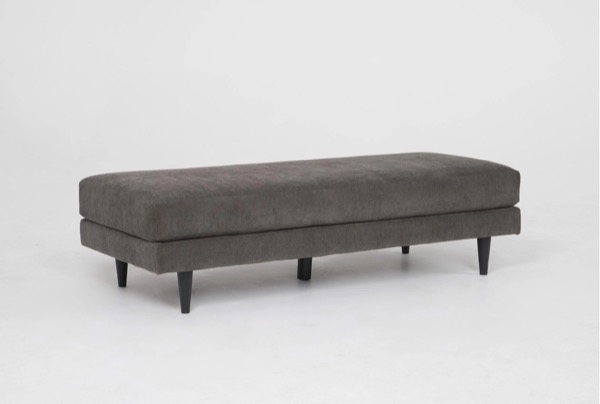 | [Living Spaces Aries II Cocktail Ottoman](https://www.livingspaces.com/pdp-aries-espresso-cocktail-ottoman-373922)                         | $495                       | 66 × 27 × 18       | Long, flat charcoal top on tapered dark legs. Clean mid-century look, free delivery         |
| 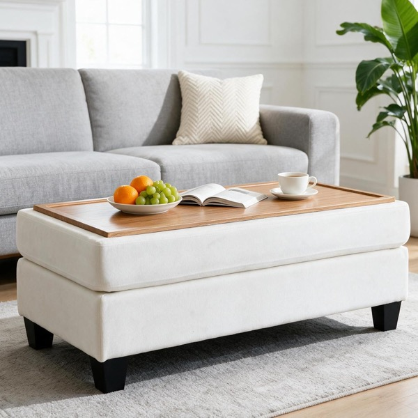  | [Arcnook Storage Ottoman, reversible tray top](https://www.amazon.com/dp/B0HHD68B6M)                                                       | $189.99                    | 45.3 × 22.4 × 18.1 | Cheapest: the lid flips from chenille to a wood tray, with storage inside                   |
| 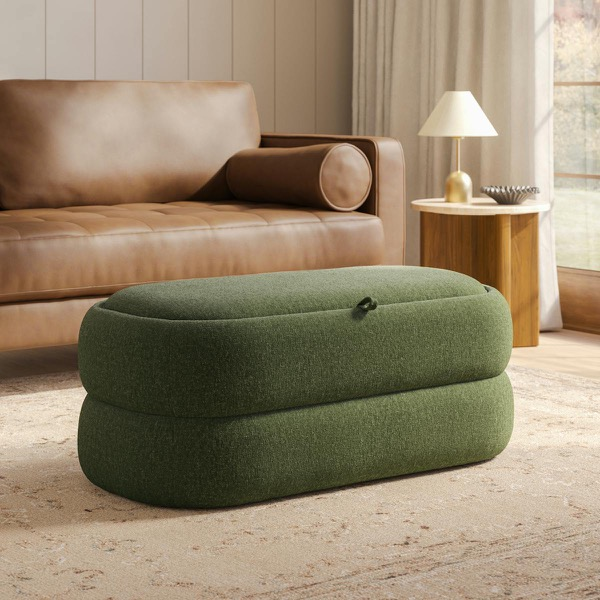           | [Article Tivvi 40" Storage Ottoman](https://www.article.com/product/30941/tivvi-40-rectangular-storage-ottoman-smoked-oak-and-clover-moss) | $699                       | 40 × 20 × 16.5     | The lid flips over to a smoked-oak tray. Soft and rounded, no legs                          |
| 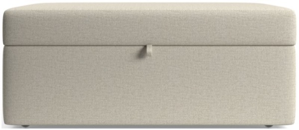  | [Crate & Barrel Lounge Classic 43" Ottoman with Tray](https://www.crateandbarrel.com/lounge-classic-43-storage-ottoman-with-tray/s390226)  | $1,099                     | 43 × 27 × 18       | A weighted tray pops up and locks in place. Soft top, casters, made to order                |

**Tops to put on it**

|                                                                                       | Item                                                                                                      | Price     | Size                                                | Why                                                                               |
| ------------------------------------------------------------------------------------- | --------------------------------------------------------------------------------------------------------- | --------- | --------------------------------------------------- | --------------------------------------------------------------------------------- |
| 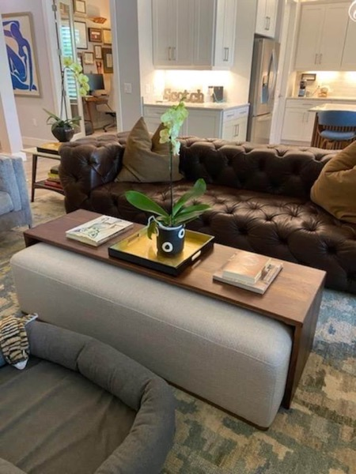    | [Custom walnut ottoman table (Etsy)](https://www.etsy.com/listing/1059969891)                             | from $899 | 18" wide, built to your ottoman's length and height | Straddles the whole ottoman, so it's the most like a coffee table. Made to order  |
| 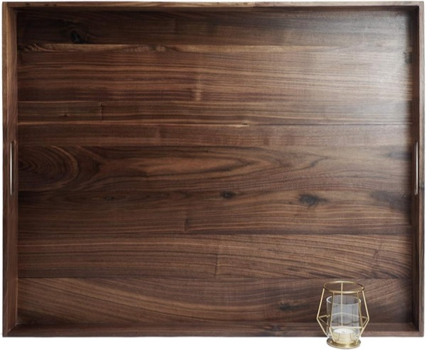     | [MAGIGO walnut ottoman tray](https://www.amazon.com/dp/B07QM18CX1)                                        | $143.99   | 30 × 24 × 2.5                                       | Big, rigid walnut tray with a raised edge                                         |
| 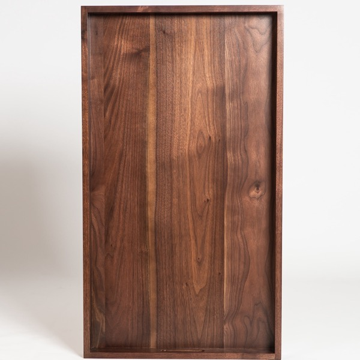 | [KINGCRAFT walnut ottoman tray](https://www.walmart.com/ip/5683691527)                                    | $124.99   | 32 × 18 × 2.4                                       | Long and narrow, suits a bench. The bottom has gaps, so it may not sit flat       |
| 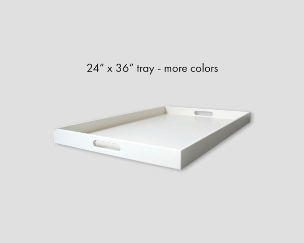           | [24 × 36 rectangle tray with handles (Etsy)](https://www.etsy.com/listing/501684539)                      | $278      | 36 × 24 × 2.5                                       | Largest tray, sold as an ottoman topper. Painted colors only, no walnut confirmed |
| 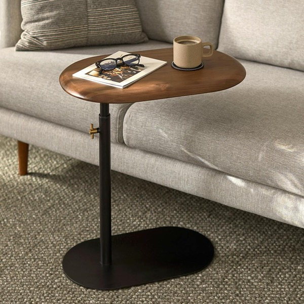        | [Article Portima C Side Table, walnut](https://www.article.com/product/29030/portima-c-side-table-walnut) | $199      | 22 × 14 × 19–26.5                                   | Slides over one end of the ottoman. Height adjusts to clear an 18" ottoman        |
